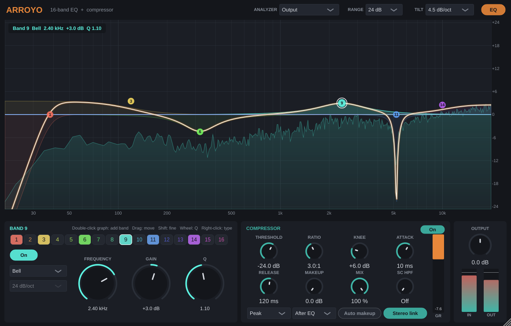

# Arroyo EQ

A free 16-band parametric EQ with a draggable curve, a live spectrum analyzer
and a built-in compressor. VST3 for Windows (tested for MPC 3 desktop).

No accounts, no registration, no internet connection, no telemetry. It never
contacts anything.



## Install (Windows, MPC 3)

1. Download `ArroyoEQ-Windows-VST3.zip`. Before unzipping: right-click it,
   choose **Properties**, tick **Unblock** if it is shown, click **OK**.
2. Copy the **`Arroyo EQ.vst3`** folder into
   `C:\Program Files\Common Files\VST3\`
3. In MPC 3: **Preferences > Plugins**, rescan. Arroyo EQ appears under the
   manufacturer "Arroyo".

## Using the EQ

| Action | How |
|---|---|
| Add a band | Double-click an empty spot on the graph |
| Move a band | Drag its numbered node (left/right = frequency, up/down = gain) |
| Fine adjustment | Hold **Shift** while dragging |
| Change width (Q) | Mouse wheel over the node (or the Q knob) |
| Type / slope / on-off | Right-click the node, or use the band panel |
| Turn a band off | Double-click its node |
| Select a band | Click its node or its number button (1-16) |

Band types: Bell, Low Shelf, High Shelf, Low Cut, High Cut (12/24/36/48 dB per
octave), Notch, Band Pass. For cut filters, dragging up/down changes the
resonance (Q) instead of gain.

The **analyzer** shows the input, the output, or both. **Range** sets the
graph's dB scale (12/24/36). **Tilt** slopes the analyzer display (4.5 dB/oct
makes typical music look roughly flat); it does not change the sound.

The **EQ** button at top right bypasses all bands (with a short fade, so no
click).

## Compressor

| Control | What it does |
|---|---|
| Threshold | Level above which compression starts |
| Ratio | 4:1 means 4 dB over the threshold comes out as 1 dB over |
| Knee | Width of the gradual transition around the threshold (0 = hard) |
| Attack / Release | How fast gain reduction starts / recovers |
| Makeup | Gain added after compression; **Auto makeup** estimates it |
| Mix | Blend of compressed and dry signal (parallel compression) |
| SC HPF | High-pass on the detector only, so bass doesn't cause pumping |
| Peak / RMS | Detector responds to peaks, or to average level |
| After EQ / Before EQ | Where the compressor sits in the chain |
| Stereo link | Same gain reduction on both channels (keeps the stereo image) |

The **GR** meter shows the current gain reduction in dB.

## Technical notes

- Filters: trapezoidal state-variable filters (Simper/Cytomic). The displayed
  curve is computed from the exact digital filters, and the test suite checks
  that it matches the measured response (`tests/dsp_tests.cpp`).
- Parameter changes glide over ~20 ms; type changes cross-fade. Automation is
  click-free.
- Compressor: feed-forward, log-domain soft-knee gain computer with branching
  attack/release (Giannoulis, Massberg & Reiss, JAES 2012).
- No added latency. 32- and 64-bit processing. Mono or stereo.

## Building

Requires CMake 3.22+ and a C++17 compiler. JUCE 8.0.15 is fetched automatically.

```
cmake -B build -A x64            # Windows (Visual Studio 2022)
cmake --build build --config Release --target ArroyoEQ_VST3
```

The GitHub Actions workflow builds and validates the Windows VST3 on every push.

## License

Arroyo EQ's own source code is under the MIT License (see `LICENSE`). It is
built with the JUCE framework, which is used under JUCE's own licence.
VST is a registered trademark of Steinberg Media Technologies GmbH.
